# Домашнее задание к занятию «Практическое применение Terraform» - Шичков Евгений

---

## Задание 0

Ознакомился с документацией к security-groups в Yandex Cloud.

---

## Задание 1

### 1. Создание сервисного аккаунта и ключа
Создан сервисный аккаунт `terra` и авторизованный ключ для доступа к Yandex Cloud. Настроен профиль в Yandex CLI.

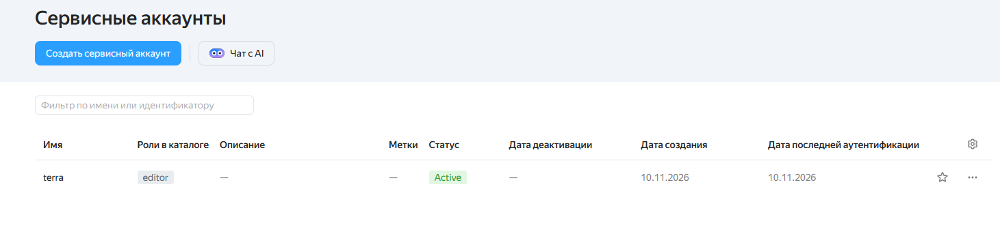
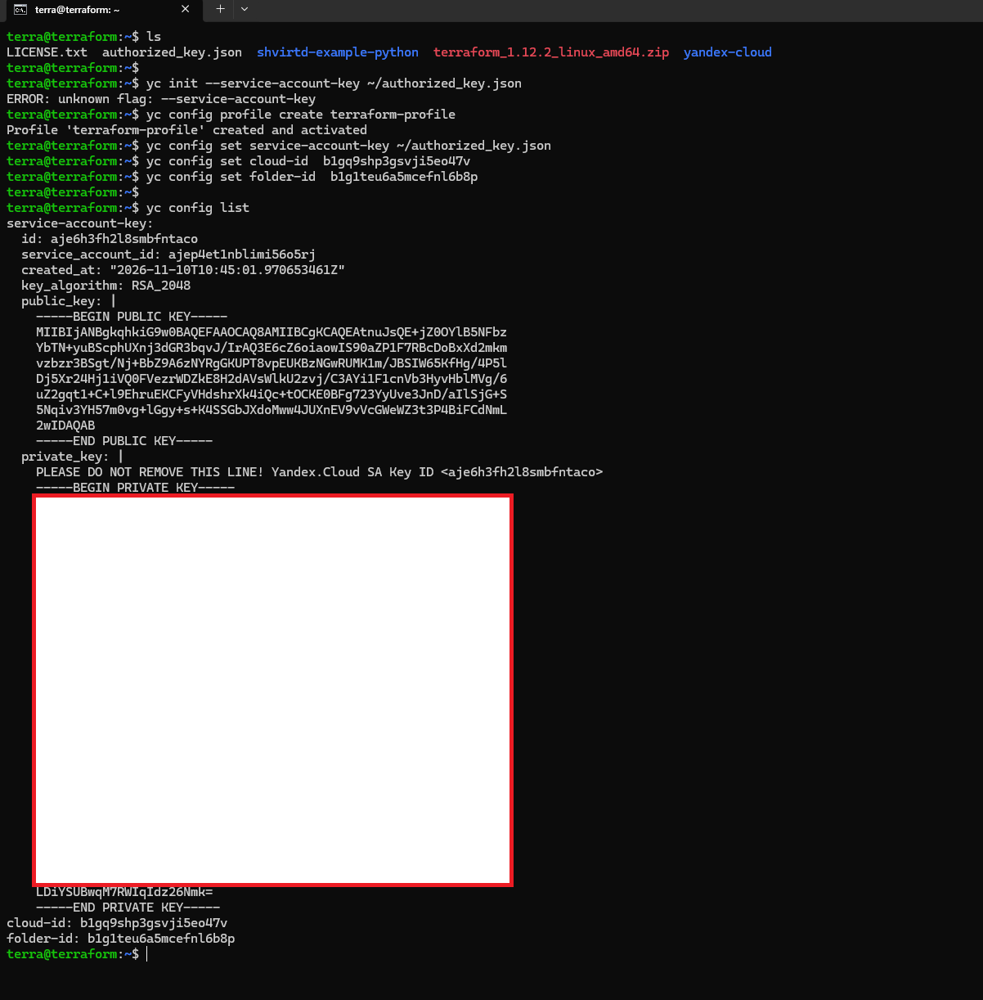


### 2. Исправление синтаксических ошибок
В ходе выполнения были найдены и исправлены три намеренные ошибки:
1. **В `main.tf`**: Опечатка в платформе `standart-v4` (исправлено на `standard-v4`, но из-за ограничений облака итоговая версия — `standard-v2`).
2. **В `variables.tf`**: Имя переменной `vms_ssh_root_key` не совпадало с вызовом в `main.tf` (переименовано в `vms_ssh_public_root_key`).
3. **В `variables.tf`**: Вместо заглушки `"your_ssh_ed25519_key"` был вставлен реальный публичный SSH-ключ.

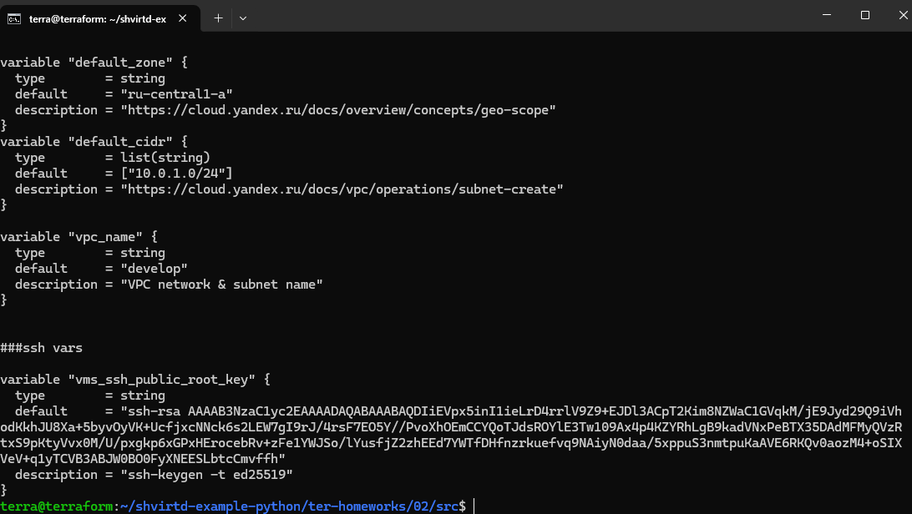

### 3. Ответы на вопросы
*   **`preemptible = true`**: Это создание прерываемой ВМ. Такие машины стоят значительно дешевле, могут быть остановлены в любой моменте.
*   **`core_fraction = 5`**: Этот параметр задает гарантированную долю производительности vCPU в процентах 5% от ядра. Такой минимум отлично подходит для слабонагруженных задач и цена ниже соответственно

### 4. Скриншоты выполнения

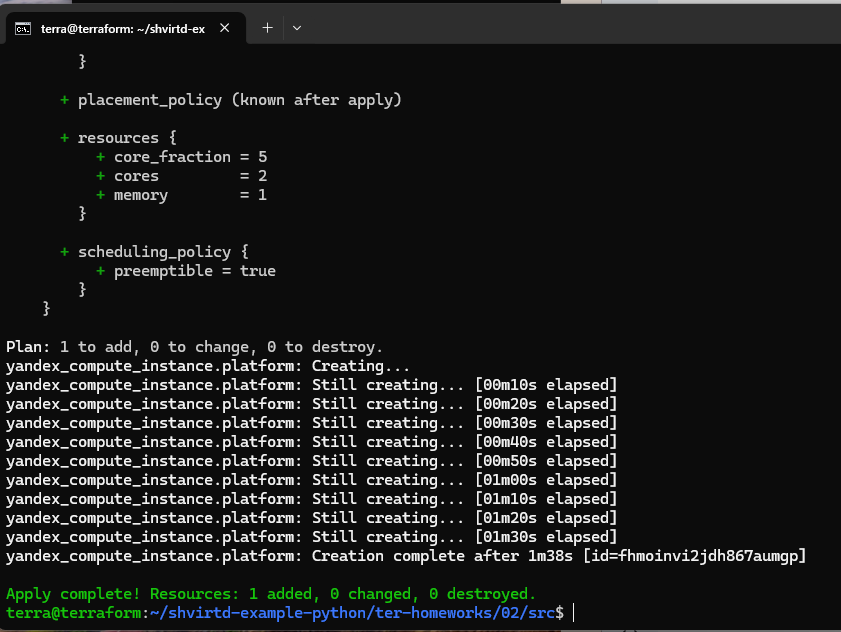

**Скриншот консоли с выполнением `curl ifconfig.me`:**
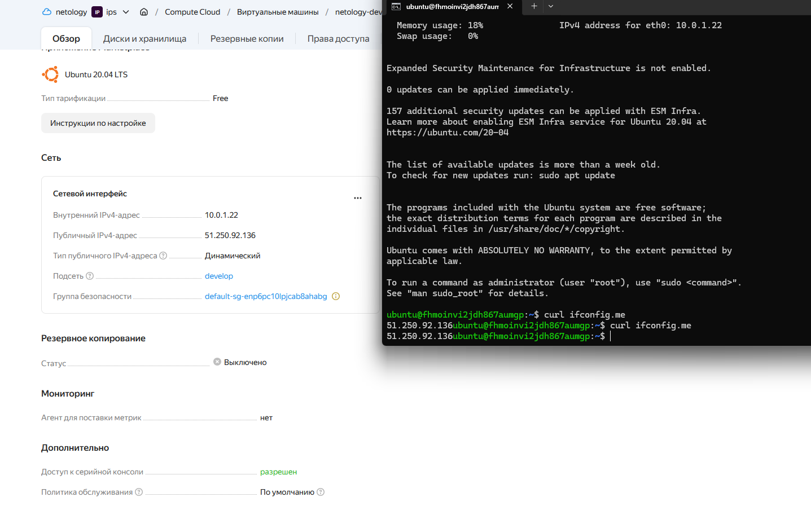

---

## Задание 2

Все хардкод-значения для `yandex_compute_image` и `yandex_compute_instance` заменены на переменные с префиксом `vm_web_`:
* `vm_web_name`
* `vm_web_platform_id`
* `vm_web_cores`
* `vm_web_memory`
* `vm_web_core_fraction`
* `vm_web_family`

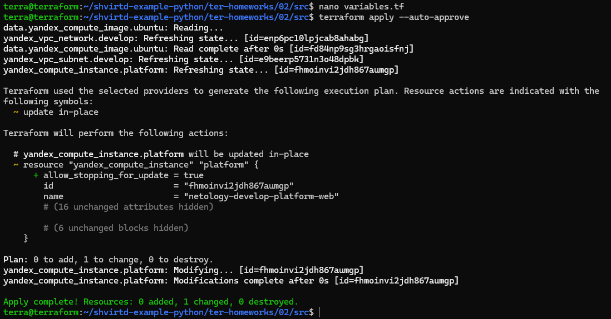
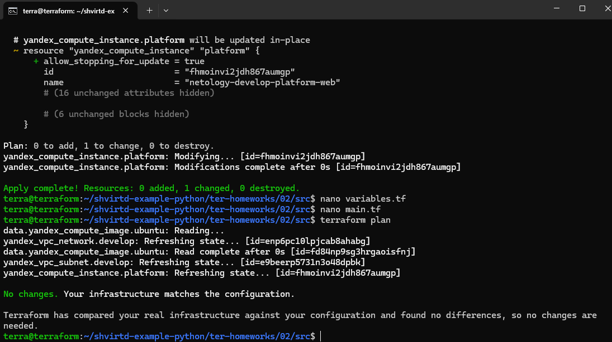


Переменные объявлены в `variables.tf` с указанием типов и значений по умолчанию. Команда `terraform plan` показала отсутствие изменений (`No changes`).

---

## Задание 3

В корне проекта создан файл `vms_platform.tf`, в который перенесены все переменные первой ВМ. В файле `main.tf` создана вторая ВМ `netology-develop-platform-db` с параметрами: `cores = 2`, `memory = 2`, `core_fraction = 20`.

**ПРО ЗОНУ!** По заданию вторая ВМ должна быть в зоне `ru-central1-b`, на момент выполнения (10.11.2026) эта зона была недоступна из-за аварии в дата-центре Yandex Cloud Чтобы обеспечить работоспособность конфигурации, вторая ВМ была размещена в зоне `ru-central1-a` (в той же подсети, что и первая). Код написан корректно и легко переключается обратно при восстановлении зоны.

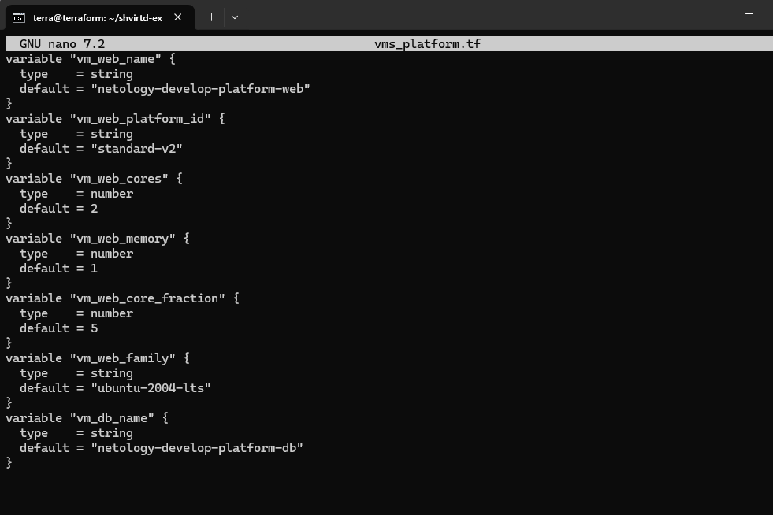
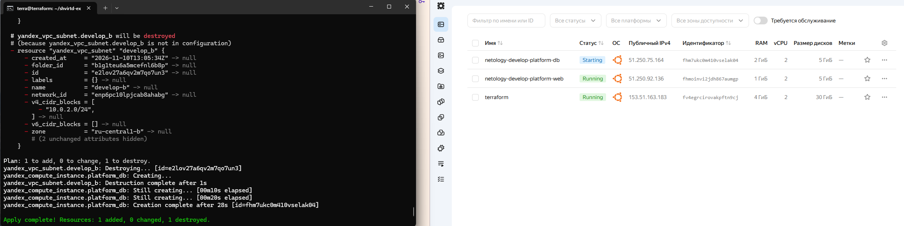
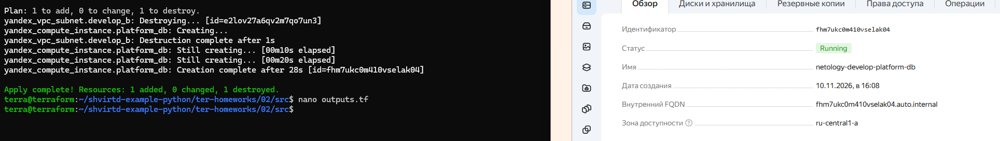

---

## Задание 4

В файле `outputs.tf` объявлены два output-блока для вывода `instance_name`, `external_ip` и `fqdn` для каждой из ВМ.

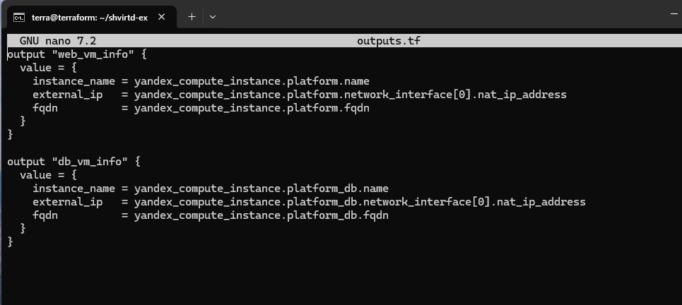
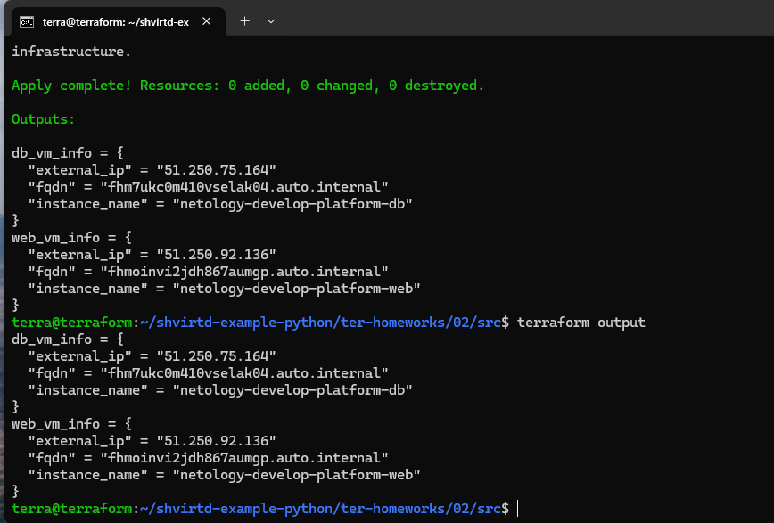

---

## Задание 5

В файле `locals.tf` описаны имена каждой ВМ с использованием интерполяции и нескольких переменных:
```hcl
locals {
  web_name = "${var.vm_web_name}-${var.vpc_name}"
  db_name  = "${var.vm_db_name}-${var.vpc_name}"
}
```

Внутри ресурсов ВМ переменные `name` заменены на созданные локальные переменные `local.web_name` и `local.db_name`

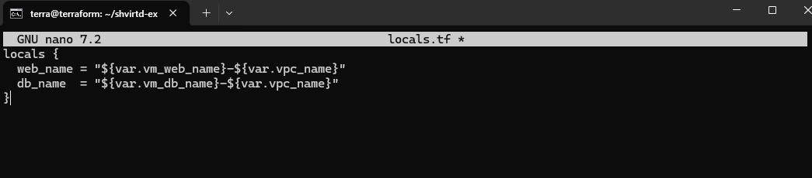
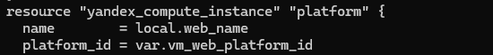
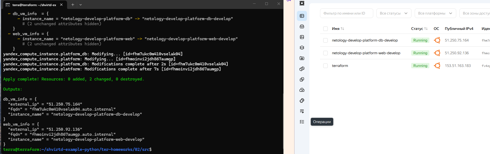

## Задание 6

В ходе выполнения задания была проведена оптимизация и рефакторинг переменных.

### 1. Объединение ресурсов в map-переменную
Вместо отдельных переменных для ядер, памяти и доли CPU была создана единая map-переменная `vms_resources` в файле `variables.tf`:
```hcl
variable "vms_resources" {
  type = map(object({
    cores         = number
    memory        = number
    core_fraction = number
  }))
}
```

Значения для каждой ВМ заданы в `terraform.tfvars`:

```hcl
vms_resources = {
  web = {
    cores         = 2
    memory        = 1
    core_fraction = 5
  }
  db = {
    cores         = 2
    memory        = 2
    core_fraction = 20
  }
}
```
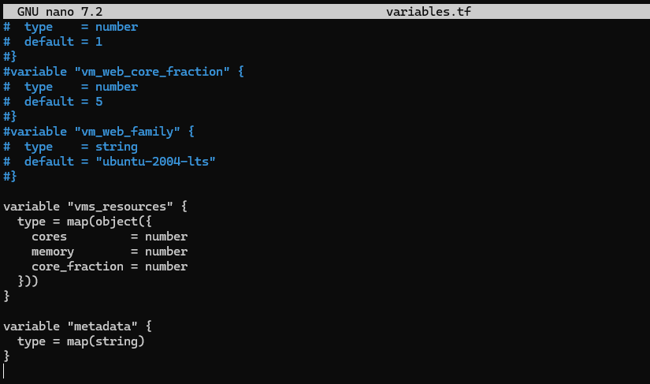
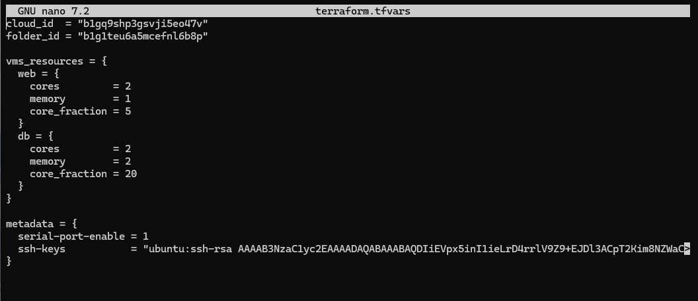

### 2. Создание общей map-переменной для metadata

Блок метаданных был вынесен в отдельную map-переменную `metadata` для использования обеими виртуальными машинами. В `terraform.tfvars` она выглядит так:

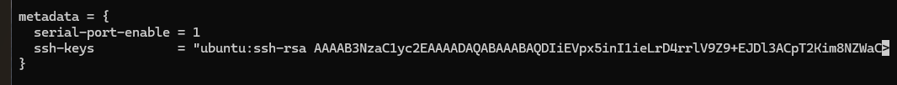

```hcl
metadata = {
  serial-port-enable = 1
  ssh-keys           = "ubuntu:ssh-rsa AAAAB3NzaC1yc2EAAAA..."
}
```
### 3. Применение новых переменных в main.tf

В блоках ресурсов `yandex_compute_instance` (web и db) старые переменные были заменены на обращения к новым map-переменным:
    `cores = var.vms_resources["web"].cores`
    `memory = var.vms_resources["web"].memory`
    `core_fraction = var.vms_resources["web"].core_fraction`
    `metadata = var.metadata`

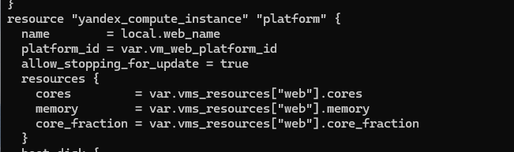
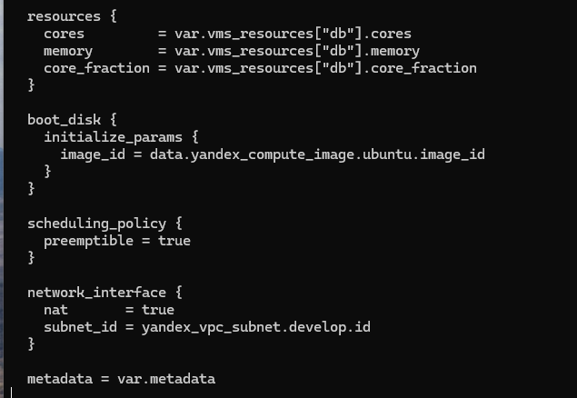

### 4. Комментирование неиспользуемых переменных

Все старые, более не используемые переменные (например, `vm_web_cores,` `vm_web_memory`, `vms_ssh_public_root_key` и т.д.) были закомментированы в файлах `variables.tf` и `vms_platform.tf.`

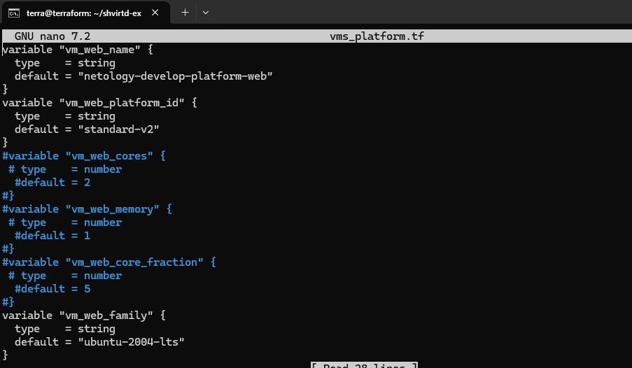

### 5. Проверка изменений

После внесения всех изменений была выполнена команда `terraform plan`, которая подтвердила, что инфраструктура соответствует конфигурации и изменений не требуется.

No changes. Your infrastructure matches the configuration.

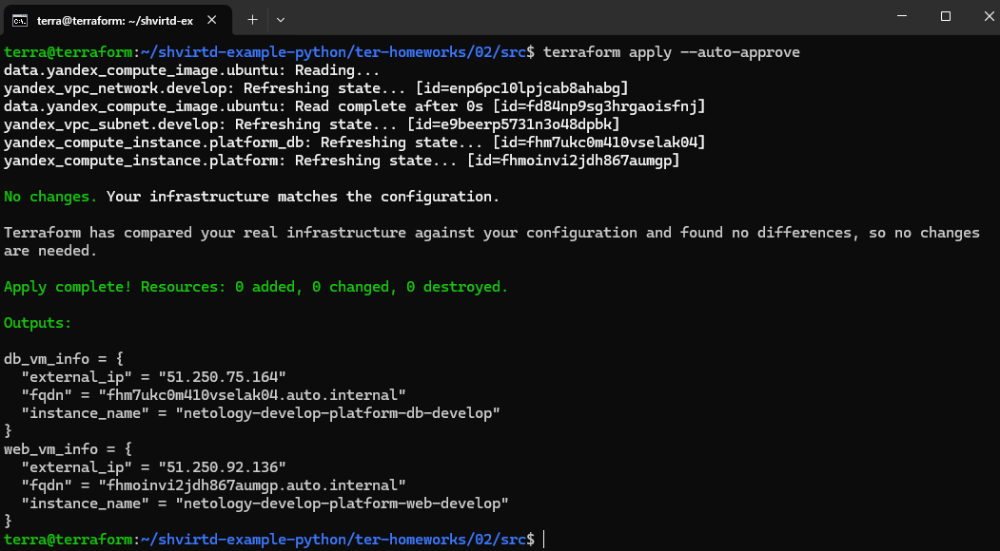
